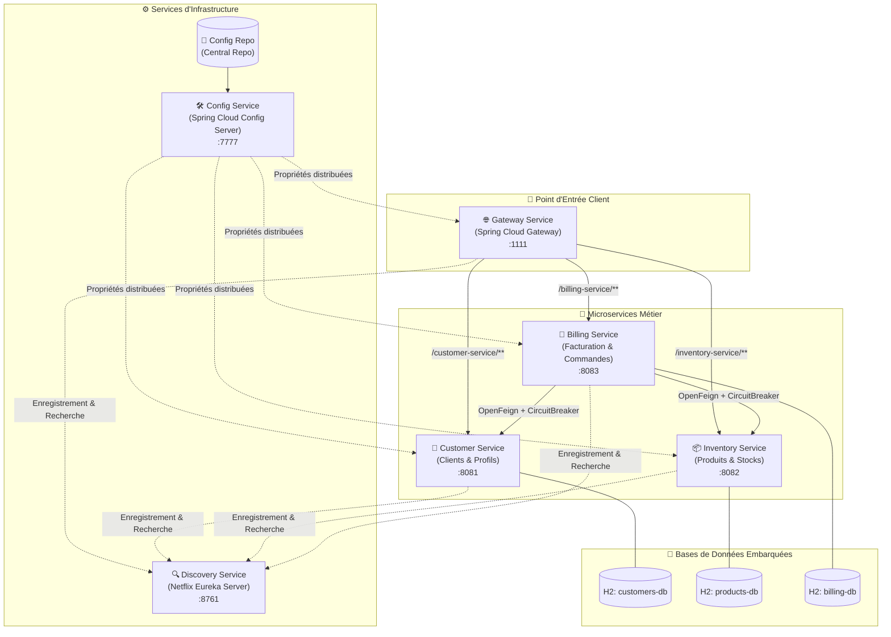

# 🛒 EcomCloudSuite — Architecture Microservices avec Spring Cloud

[](https://openjdk.org/)
[](https://spring.io/projects/spring-boot)
[](https://spring.io/projects/spring-cloud)
[](https://cloud.spring.io/spring-cloud-netflix/)
[](https://spring.io/projects/spring-cloud-gateway)
[](https://resilience4j.readme.io/)

**EcomCloudSuite** est une plateforme e-commerce distribuée hautement résiliente et modulaire, conçue selon les principes de l'**architecture microservices** avec **l'écosystème Spring Cloud**. Le projet illustre les patrons de conception clés des architectures distribuées modernes : externalisation et centralisation de configuration, découverte dynamique de services, routage intelligent par passerelle d'API, invocation inter-services synchrone et tolérance aux pannes via le pattern Circuit Breaker.

---

## 📐 Architecture Globale du Système



---

## 🧩 Modules & Responsabilités

### 1. `config-service` (Port: `7777`)

- **Rôle** : Serveur de configuration centralisé (**Spring Cloud Config Server**).
- **Fonctionnement** : Charge dynamiquement à l'exécution les fichiers de configuration centralisés situés dans `config-repo` (profils `default`, `dev`, `prod`). Il alimente l'ensemble des microservices sans nécessiter de redémarrage.

### 2. `discovery-service` (Port: `8761`)

- **Rôle** : Annuaire de services (**Netflix Eureka Server**).
- **Fonctionnement** : Permet aux microservices clients (`customer-service`, `inventory-service`, `billing-service`) et à la passerelle de s'enregistrer dynamiquement et de résoudre les adresses des instances disponibles en temps réel.

### 3. `gateway-service` (Port: `1111`)

- **Rôle** : Passerelle d'API réactive (**Spring Cloud Gateway** basée sur Spring WebFlux & Netty).
- **Fonctionnement** : Agit comme point d'entrée unique pour les clients externes. Il implémente un routage dynamique vers les services enregistrés dans Eureka (`lb://CUSTOMER-SERVICE`, `lb://INVENTORY-SERVICE`, `lb://BILLING-SERVICE`) via `DiscoveryClientRouteDefinitionLocator`.

### 4. `customer-service` (Port: `8081`)

- **Rôle** : Gestion des clients et de leurs coordonnées.
- **Technologies** : Spring Data JPA, Spring Data REST, H2 Database (`customers-db`), Spring Boot Actuator.
- **Fonctionnalités avancées** :
  - Exposition automatique d'API REST HATEOAS.
  - Projections de données (`CustomerProjection` exposant `id` et `name`, `CustomerProjectionEmail` exposant `email`).
  - Contrôleur de test de rafraîchissement des paramètres distribués (`/params`).

### 5. `inventory-service` (Port: `8082`)

- **Rôle** : Catalogue des produits et gestion de stock.
- **Technologies** : Spring Data JPA, Spring Data REST (préfixe `/api`), H2 Database (`products-db`).
- **Fonctionnalités avancées** :
  - Exposition automatique d'API REST pour les entités `Product` (`id`, `name`, `price`, `quantity`).
  - Configuration `RestRepositoryConfig` forçant l'exposition des identifiants d'entités dans les payloads JSON.

### 6. `billing-service` (Port: `8083`)

- **Rôle** : Gestion de la facturation et agrégation des commandes.
- **Technologies** : Spring Data JPA, Spring Cloud OpenFeign, Resilience4j Circuit Breaker.
- **Fonctionnalités avancées** :
  - Entités relationnelles `Bill` et `ProductItem`.
  - Clients déclaratifs OpenFeign (`CustomerServiceRestClient`, `InventoryServiceRestClient`).
  - Tolérance aux pannes : Protection par **Circuit Breaker** (Resilience4j) avec méthodes de secours (**Fallback**) renvoyant des objets par défaut en cas d'indisponibilité des services tiers.
  - Endpoint REST agrégé `/api/bills/{id}` qui assemble la facture, les coordonnées du client et le détail des produits enrichis à la volée.

---

## 🛡️ Tolérance aux Pannes & Résilience (Resilience4j)

Le microservice de facturation (`billing-service`) utilise **Resilience4j** pour isoler les défaillances réseau :

```java
@FeignClient(name = "customer-service")
public interface CustomerServiceRestClient {
    @GetMapping("/customers/{id}")
    @CircuitBreaker(name = "customerService", fallbackMethod = "getDefaultCustomer")
    Customer findCustomerById(@PathVariable Long id);

    default Customer getDefaultCustomer(Long id, Exception e) {
        Customer customer = new Customer();
        customer.setId(id);
        customer.setName("Default Customer");
        customer.setEmail("default@gmail.com");
        return customer;
    }
}
```

Si le service client ou inventaire tombe, l'appelant bascule automatiquement et de manière transparente sur la méthode `fallbackMethod`, garantissant ainsi la disponibilité continue de l'API de facturation.

---

## 🚀 Ordre de Démarrage des Services

Pour garantir la résolution des dépendances et de la configuration, lancez les services dans l'ordre suivant :

1. **`config-service`** : Initialise le serveur de configuration (`http://localhost:7777`).
2. **`discovery-service`** : Lance l'annuaire Eureka (`http://localhost:8761`).
3. **`customer-service`** : Démarre le service client et s'enregistre sur Eureka (`http://localhost:8081`).
4. **`inventory-service`** : Démarre le service inventaire et s'enregistre sur Eureka (`http://localhost:8082`).
5. **`billing-service`** : Démarre le service facturation et ses clients Feign (`http://localhost:8083`).
6. **`gateway-service`** : Lance la passerelle API d'accès unifié (`http://localhost:1111`).

---

## 🧪 Endpoints & Validation des Fonctionnalités

### Accès direct via l'API Gateway (`http://localhost:1111`)

| Méthode | Route Gateway                                                 | Service Cible       | Description                                                |
| :-----: | :------------------------------------------------------------ | :------------------ | :--------------------------------------------------------- |
|  `GET`  | `/customer-service/customers`                                 | `customer-service`  | Liste HATEOAS de tous les clients                          |
|  `GET`  | `/customer-service/customers/1`                               | `customer-service`  | Détail du client #1                                        |
|  `GET`  | `/customer-service/customers/1?projection=customerProjection` | `customer-service`  | Vue projetée (ID + Nom uniquement)                         |
|  `GET`  | `/inventory-service/api/products`                             | `inventory-service` | Liste de tous les produits du catalogue                    |
|  `GET`  | `/inventory-service/api/products/{id}`                        | `inventory-service` | Fiche détaillée d'un produit par ID                        |
|  `GET`  | `/billing-service/bills`                                      | `billing-service`   | Liste des factures brutes                                  |
|  `GET`  | `/billing-service/api/bills/{id}`                             | `billing-service`   | **Facture complète agrégée** (Client + Produits via Feign) |

### Dashboards et Outils

- **Tableau de bord Eureka** : `http://localhost:8761/`
- **Vérification Config Server** : `http://localhost:7777/customer-service/default`
- **Consoles H2** :
  - Client DB : `http://localhost:8081/h2-console` (`jdbc:h2:mem:customers-db`)
  - Inventory DB : `http://localhost:8082/h2-console` (`jdbc:h2:mem:products-db`)
  - Billing DB : `http://localhost:8083/h2-console` (`jdbc:h2:mem:billing-db`)

---

## 📸 Captures d'Écran et Preuves de Fonctionnement

Les captures d'écran suivantes (disponibles dans le dossier [`screens/`](./screens)) illustrent le bon fonctionnement de l'infrastructure :

- **Registre Eureka (`test eureka.png`)** : Vue des microservices enregistrés en direct.
- **Serveur de Configuration (`test config-service ...`)** : Réponses JSON validant la distribution des configurations profilées (`application`, `customer-service`, etc.).
- **Routage Gateway (`test gateway ...`)** : Validation des requêtes transmises de bout en bout avec réécriture de chemins et équilibrage de charge.
- **Agrégation Facturation (`test gateway billing-service api bills id.png`)** : Facture composite assemblant dynamiquement les entités clients et produits.

---

## 🛠️ Stack Technique

- **Langage** : Java 21
- **Framework Principal** : Spring Boot 3.x / 4.x
- **Écosystème Cloud** :
  - Spring Cloud Config (Serveur de configuration natif)
  - Spring Cloud Netflix Eureka (Service Discovery & Registration)
  - Spring Cloud Gateway (Routage dynamique & WebFlux)
  - Spring Cloud OpenFeign (Client HTTP déclaratif)
  - Spring Cloud Circuit Breaker / Resilience4j (Résilience et tolérance aux pannes)
- **Données & Persistance** :
  - Spring Data JPA / Hibernate
  - Spring Data REST (Exposition HATEOAS & Projections)
  - H2 Database (Bases relationnelles in-memory)
- **Monitoring & Outils** :
  - Spring Boot Actuator
  - Lombok
  - Maven
